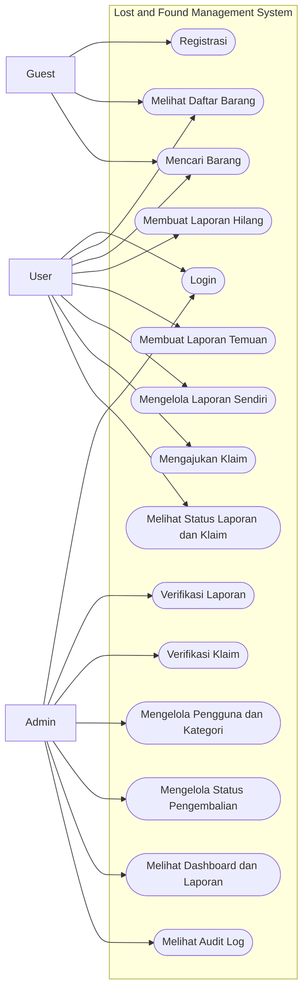
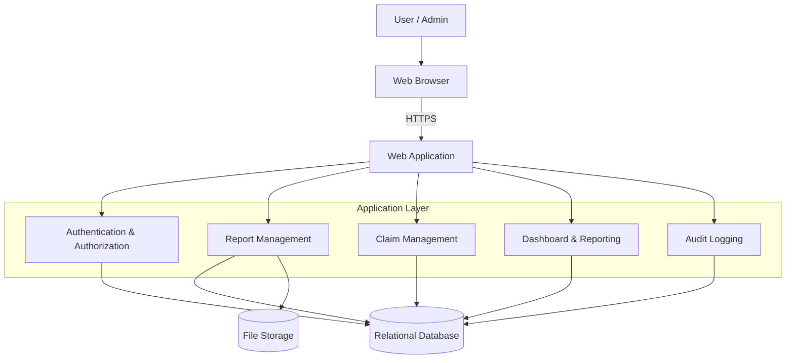
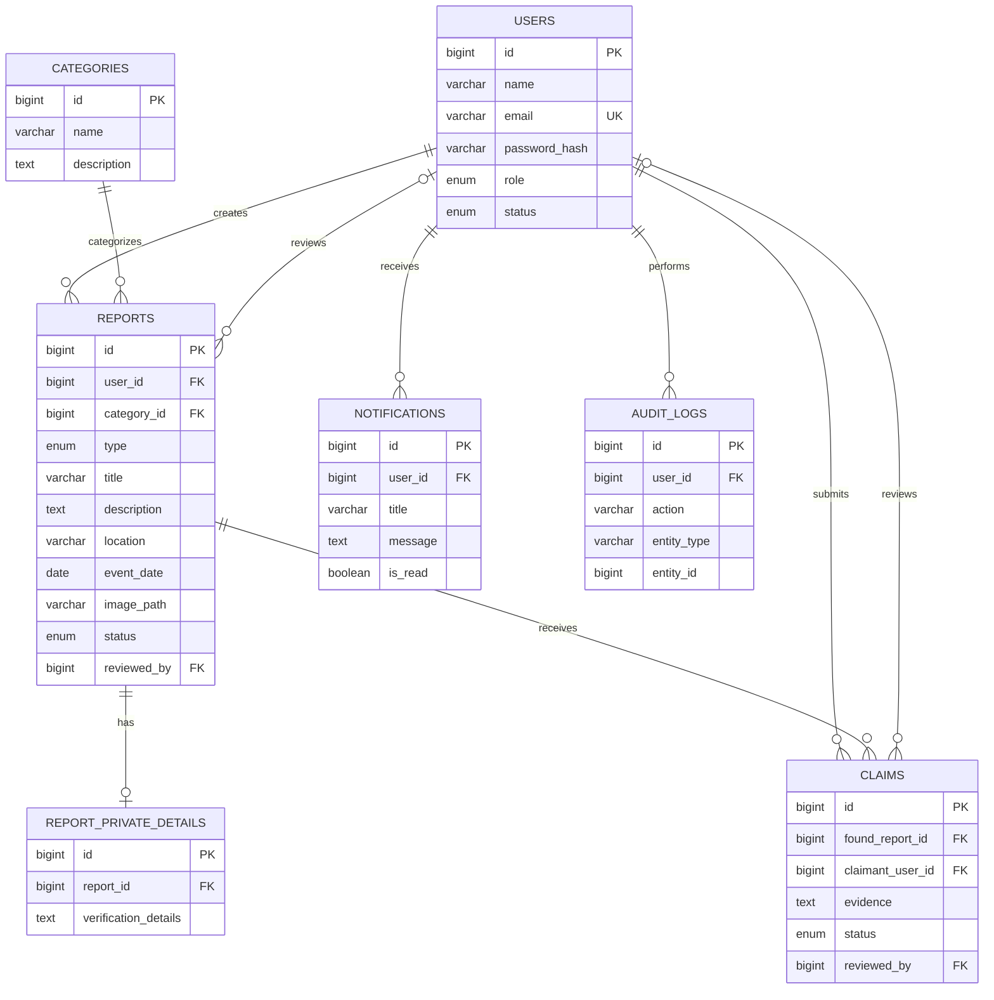

# ANALISIS KEBUTUHAN DAN PERANCANGAN LOST AND FOUND MANAGEMENT SYSTEM

## 1. Gambaran Umum Sistem

### 1.1 Nama Sistem

Lost and Found Management System

### 1.2 Deskripsi Sistem

Lost and Found Management System merupakan aplikasi berbasis web yang dirancang untuk membantu proses pelaporan, pencarian, dan pengelolaan barang hilang maupun barang temuan di lingkungan kampus.

Sistem memungkinkan mahasiswa atau pengguna terdaftar untuk melaporkan barang yang hilang, mempublikasikan informasi barang yang ditemukan, serta mengajukan klaim kepemilikan terhadap barang yang ditemukan oleh pengguna lain. Selain itu, sistem menyediakan administrator yang bertugas memverifikasi laporan, memproses klaim kepemilikan, mengelola data pengguna, dan memantau aktivitas pelaporan.

Dengan adanya sistem ini, informasi mengenai barang hilang dan barang temuan dapat dikelola secara terpusat sehingga proses pencarian dan pengembalian barang menjadi lebih terstruktur.

### 1.3 Latar Belakang

Kehilangan barang merupakan permasalahan yang dapat terjadi di lingkungan kampus, terutama pada area yang memiliki aktivitas mahasiswa cukup tinggi seperti ruang kelas, laboratorium, perpustakaan, kantin, dan area parkir.

Dalam praktiknya, informasi barang hilang atau ditemukan sering kali disebarkan melalui grup percakapan, media sosial, maupun pengumuman secara langsung. Cara tersebut memiliki beberapa keterbatasan, seperti informasi yang tersebar di berbagai tempat, sulitnya melakukan pencarian berdasarkan kategori atau lokasi, serta tidak adanya mekanisme verifikasi kepemilikan yang terstruktur.

Oleh karena itu, diperlukan sebuah sistem terpusat yang dapat mengelola informasi barang hilang dan temuan, menyediakan fasilitas pencarian, serta mendukung proses verifikasi klaim kepemilikan. Sistem ini juga memperhatikan aspek keamanan informasi, khususnya dalam pengelolaan akun pengguna, pembatasan hak akses, perlindungan informasi pribadi, dan keamanan data laporan.

### 1.4 Tujuan Sistem

1. Menyediakan platform terpusat untuk pelaporan barang hilang dan barang temuan.
2. Mempermudah pengguna mencari informasi barang berdasarkan nama, kategori, tanggal, dan lokasi.
3. Menyediakan mekanisme pengajuan dan verifikasi klaim kepemilikan barang.
4. Membantu administrator mengelola laporan dan aktivitas pengembalian barang.
5. Menjaga keamanan serta kerahasiaan informasi pengguna dan data laporan.

---

## 2. Analisis Kebutuhan Sistem

### 2.1 Identifikasi Pengguna

Sistem memiliki tiga jenis aktor utama:

| Aktor | Deskripsi |
| --- | --- |
| **Guest** | Pengunjung yang belum memiliki akun atau belum login. |
| **User** | Pengguna terdaftar yang dapat membuat laporan barang hilang, barang temuan, dan mengajukan klaim. |
| **Admin** | Pengelola sistem yang bertanggung jawab atas verifikasi laporan, klaim kepemilikan, dan pengelolaan data. |

### 2.2 Analisis Kebutuhan Fungsional

Kebutuhan fungsional menjelaskan fitur dan layanan yang harus disediakan oleh sistem.

| ID | Kebutuhan Fungsional | Aktor |
| --- | --- | --- |
| FR-01 | Sistem menyediakan registrasi akun pengguna. | Guest |
| FR-02 | Sistem menyediakan fitur login dan logout. | User, Admin |
| FR-03 | Pengguna dapat melihat daftar barang hilang dan barang temuan yang telah dipublikasikan. | Guest, User |
| FR-04 | Pengguna dapat mencari dan memfilter barang berdasarkan nama, kategori, lokasi, dan tanggal. | Guest, User |
| FR-05 | Pengguna dapat membuat laporan barang hilang. | User |
| FR-06 | Pengguna dapat membuat laporan barang temuan. | User |
| FR-07 | Pengguna dapat melihat, mengubah, dan menghapus laporan miliknya sendiri sesuai status laporan. | User |
| FR-08 | Pengguna dapat mengajukan klaim kepemilikan terhadap barang temuan. | User |
| FR-09 | Pengguna dapat melihat status laporan dan pengajuan klaim miliknya. | User |
| FR-10 | Admin dapat melihat dan memverifikasi laporan barang hilang maupun temuan. | Admin |
| FR-11 | Admin dapat menerima atau menolak laporan yang dikirim pengguna. | Admin |
| FR-12 | Admin dapat memeriksa dan memproses pengajuan klaim kepemilikan. | Admin |
| FR-13 | Admin dapat memperbarui status barang setelah proses pengembalian selesai. | Admin |
| FR-14 | Admin dapat mengelola data kategori barang dan pengguna. | Admin |
| FR-15 | Sistem menyediakan notifikasi mengenai perubahan status laporan dan klaim. | User, Admin |
| FR-16 | Sistem menyediakan dashboard dan laporan rekap aktivitas barang hilang maupun temuan. | Admin |
| FR-17 | Sistem menyediakan pencatatan aktivitas penting pengguna dan administrator. | Admin |

### 2.3 Analisis Kebutuhan Nonfungsional

| Aspek | Kebutuhan |
| --- | --- |
| **Security** | Sistem harus menggunakan password hashing, validasi input, proteksi SQL Injection dan XSS, serta kontrol akses berdasarkan peran. |
| **Authentication** | Sistem harus memiliki mekanisme autentikasi yang aman untuk membatasi akses pengguna. |
| **Authorization** | Pengguna hanya dapat mengelola data miliknya sendiri, sedangkan pengelolaan seluruh data dilakukan oleh admin. |
| **Performance** | Sistem harus mampu menampilkan daftar laporan dan hasil pencarian tanpa waktu tunggu yang berlebihan. |
| **Availability** | Aplikasi harus dapat diakses melalui internet setelah dipublikasikan. |
| **Compatibility** | Antarmuka harus dapat digunakan melalui browser desktop maupun perangkat mobile. |
| **Usability** | Sistem harus memiliki navigasi yang mudah dipahami dan formulir pelaporan yang sederhana. |
| **Maintainability** | Struktur aplikasi harus modular agar mudah diperbaiki dan dikembangkan. |
| **Data Integrity** | Sistem harus menjaga konsistensi data laporan, klaim, dan status pengembalian barang. |

### 2.4 Kebutuhan Keamanan

Karena aplikasi dikembangkan untuk mata kuliah Cyber Security, aspek keamanan menjadi kebutuhan utama.

| No. | Aspek Keamanan | Rancangan Penerapan |
| --- | --- | --- |
| 1 | Password Hashing | Password disimpan menggunakan bcrypt atau Argon2. |
| 2 | SQL Injection | Menggunakan prepared statement atau ORM serta validasi input. |
| 3 | Cross-Site Scripting | Melakukan output encoding dan sanitasi input yang diperlukan. |
| 4 | Authentication | Menggunakan session atau token yang dikelola secara aman. |
| 5 | Authorization | Menggunakan Role-Based Access Control (RBAC). |
| 6 | IDOR Protection | Memastikan pengguna hanya dapat mengakses laporan dan klaim miliknya sendiri. |
| 7 | Session Security | Menggunakan cookie HttpOnly, Secure, dan SameSite apabila menggunakan session berbasis cookie. |
| 8 | Rate Limiting | Membatasi percobaan login berulang untuk mengurangi risiko brute force. |
| 9 | File Upload Security | Membatasi jenis dan ukuran file serta memeriksa tipe file yang diunggah. |
| 10 | Secret Management | Menyimpan kredensial database dan secret lainnya melalui environment variable. |
| 11 | HTTPS | Seluruh komunikasi aplikasi menggunakan HTTPS. |
| 12 | Audit Logging | Mencatat aktivitas penting seperti perubahan laporan, verifikasi, dan pengelolaan pengguna. |

---

## 3. Analisis Proses Bisnis

### 3.1 Proses Pelaporan Barang Hilang

1. Pengguna melakukan login ke dalam sistem.
2. Pengguna memilih menu laporan barang hilang.
3. Pengguna mengisi formulir laporan yang terdiri dari nama barang, kategori, tanggal kehilangan, lokasi kehilangan, deskripsi, dan foto apabila tersedia.
4. Sistem melakukan validasi terhadap data yang dimasukkan.
5. Jika data valid, laporan disimpan ke database dengan status menunggu verifikasi.
6. Admin memeriksa laporan yang masuk.
7. Jika disetujui, laporan dipublikasikan sehingga dapat dilihat oleh pengguna lain.
8. Jika tidak sesuai, laporan ditolak dengan alasan yang diberikan admin.

### 3.2 Proses Pelaporan Barang Temuan

1. Pengguna melakukan login.
2. Pengguna memilih menu laporan barang temuan.
3. Pengguna mengisi informasi barang yang ditemukan.
4. Pengguna dapat memasukkan informasi khusus mengenai barang yang tidak ditampilkan kepada publik untuk kebutuhan verifikasi.
5. Sistem memvalidasi dan menyimpan laporan.
6. Admin memeriksa laporan.
7. Apabila disetujui, informasi barang temuan ditampilkan kepada pengguna lain.
8. Pengguna lain dapat mencari barang tersebut dan mengajukan klaim kepemilikan.

### 3.3 Proses Klaim Kepemilikan

1. Pengguna menemukan barang yang diduga miliknya melalui daftar barang temuan.
2. Pengguna membuka detail barang.
3. Pengguna memilih fitur ajukan klaim.
4. Pengguna memberikan informasi pendukung yang dapat membuktikan kepemilikannya, seperti ciri khusus barang atau informasi yang tidak ditampilkan pada halaman publik.
5. Sistem menyimpan pengajuan dengan status menunggu verifikasi.
6. Admin memeriksa informasi klaim dan membandingkannya dengan informasi khusus barang.
7. Admin dapat menyetujui atau menolak klaim.
8. Jika disetujui, admin mengatur proses serah terima barang.
9. Setelah barang dikembalikan kepada pemilik yang sah, admin memperbarui status transaksi menjadi selesai.

### 3.4 Proses Pengelolaan oleh Admin

1. Admin melakukan login.
2. Admin membuka dashboard administrasi.
3. Admin melihat statistik laporan dan klaim.
4. Admin memeriksa laporan baru.
5. Admin memverifikasi atau menolak laporan.
6. Admin memeriksa pengajuan klaim.
7. Admin memperbarui status barang dan klaim.
8. Admin dapat mengelola kategori, pengguna, serta melihat riwayat aktivitas sistem.

---

## 4. Aturan Bisnis Sistem

Aturan bisnis digunakan untuk memastikan seluruh proses di dalam aplikasi berjalan sesuai ketentuan.

| ID | Aturan Bisnis |
| --- | --- |
| BR-01 | Pengguna harus memiliki akun dan melakukan login untuk membuat laporan atau mengajukan klaim. |
| BR-02 | Pengunjung tanpa akun hanya dapat melihat laporan yang telah dipublikasikan. |
| BR-03 | Pengguna hanya dapat mengubah dan menghapus laporan yang dibuat menggunakan akunnya sendiri. |
| BR-04 | Laporan baru tidak langsung dipublikasikan sebelum melalui proses verifikasi admin. |
| BR-05 | Klaim hanya dapat diajukan terhadap barang temuan yang masih aktif. |
| BR-06 | Pengguna tidak dapat mengajukan klaim terhadap barang temuan yang dibuatnya sendiri. |
| BR-07 | Informasi khusus barang tidak boleh ditampilkan kepada publik. |
| BR-08 | Setiap klaim harus melalui proses verifikasi admin sebelum dinyatakan sah. |
| BR-09 | Admin memiliki hak untuk menerima atau menolak laporan maupun klaim. |
| BR-10 | Barang yang telah dikembalikan kepada pemiliknya harus memiliki status selesai atau dikembalikan. |
| BR-11 | Pengguna tidak dapat mengakses data laporan dan klaim milik pengguna lain melalui manipulasi URL atau parameter request. |
| BR-12 | Setiap perubahan status penting harus dicatat ke dalam audit log. |

---

## 5. Perancangan Sistem

### 5.1 Use Case Sistem

Aktor dan interaksi utama dengan sistem dapat digambarkan sebagai berikut:

### 5.2 Arsitektur Sistem

Sistem dirancang menggunakan pendekatan *three-layer architecture* yang memisahkan antarmuka pengguna, logika aplikasi, dan pengelolaan data.

**Penjelasan arsitektur:**

1. **Presentation Layer**: Menampilkan halaman website, formulir, dashboard, dan informasi kepada pengguna.
2. **Application Layer**: Mengelola proses bisnis, autentikasi, otorisasi, pelaporan, klaim, serta pembuatan laporan.
3. **Data Layer**: Menyimpan informasi pengguna, laporan barang, klaim, notifikasi, dan aktivitas sistem.
4. **File Storage**: Menyimpan gambar barang yang diunggah pengguna secara terpisah dari data utama.

Komunikasi antara browser dan aplikasi dilakukan melalui HTTPS.

### 5.3 Perancangan Database

Database dirancang menggunakan model relasional. Berikut entitas utama yang dibutuhkan:

**A. Tabel `users**`

| Field | Tipe Data | Keterangan |
| --- | --- | --- |
| `id` | BIGINT | Primary Key |
| `name` | VARCHAR(100) | Nama pengguna |
| `email` | VARCHAR(150) | Email, unique |
| `password_hash` | VARCHAR(255) | Password hasil hashing |
| `role` | ENUM | USER / ADMIN |
| `status` | ENUM | ACTIVE / SUSPENDED |
| `created_at` | TIMESTAMP | Tanggal pembuatan akun |
| `updated_at` | TIMESTAMP | Tanggal perubahan data |

**B. Tabel `categories**`

| Field | Tipe Data | Keterangan |
| --- | --- | --- |
| `id` | BIGINT | Primary Key |
| `name` | VARCHAR(100) | Nama kategori |
| `description` | TEXT | Deskripsi kategori |
| `created_at` | TIMESTAMP | Tanggal pembuatan |
| *Contoh kategori: Elektronik, Dokumen, Aksesori, Pakaian, dan Lainnya.* |  |  |

**C. Tabel `reports**`
Tabel ini digunakan untuk menyimpan laporan barang hilang dan barang temuan.

| Field | Tipe Data | Keterangan |
| --- | --- | --- |
| `id` | BIGINT | Primary Key |
| `user_id` | BIGINT | Foreign Key ke `users` |
| `category_id` | BIGINT | Foreign Key ke `categories` |
| `type` | ENUM | LOST / FOUND |
| `title` | VARCHAR(150) | Nama barang |
| `description` | TEXT | Deskripsi publik |
| `location` | VARCHAR(255) | Lokasi kehilangan atau penemuan |
| `event_date` | DATE | Tanggal kehilangan atau penemuan |
| `image_path` | VARCHAR(255) | Lokasi file gambar |
| `status` | ENUM | PENDING_REVIEW / PUBLISHED / REJECTED / RESOLVED / CLOSED |
| `reviewed_by` | BIGINT | Admin yang melakukan verifikasi |
| `reviewed_at` | TIMESTAMP | Waktu verifikasi |
| `created_at` | TIMESTAMP | Waktu pembuatan |
| `updated_at` | TIMESTAMP | Waktu perubahan |

**D. Tabel `report_private_details**`
Tabel ini menyimpan informasi khusus barang yang tidak boleh ditampilkan kepada publik.

| Field | Tipe Data | Keterangan |
| --- | --- | --- |
| `id` | BIGINT | Primary Key |
| `report_id` | BIGINT | Foreign Key ke `reports` |
| `verification_details` | TEXT | Ciri khusus barang untuk verifikasi |
| *Akses terhadap tabel ini dibatasi untuk pihak yang berwenang.* |  |  |

**E. Tabel `claims**`
Tabel ini menyimpan pengajuan klaim kepemilikan barang temuan.

| Field | Tipe Data | Keterangan |
| --- | --- | --- |
| `id` | BIGINT | Primary Key |
| `found_report_id` | BIGINT | Foreign Key ke `reports` |
| `claimant_user_id` | BIGINT | Foreign Key ke `users` |
| `evidence` | TEXT | Informasi pendukung kepemilikan |
| `status` | ENUM | PENDING / APPROVED / REJECTED / COMPLETED / CANCELLED |
| `reviewed_by` | BIGINT | Admin yang memproses klaim |
| `admin_note` | TEXT | Catatan verifikasi |
| `created_at` | TIMESTAMP | Waktu pengajuan |
| `updated_at` | TIMESTAMP | Waktu perubahan |

**F. Tabel `notifications**`

| Field | Tipe Data | Keterangan |
| --- | --- | --- |
| `id` | BIGINT | Primary Key |
| `user_id` | BIGINT | Foreign Key ke `users` |
| `title` | VARCHAR(150) | Judul notifikasi |
| `message` | TEXT | Isi notifikasi |
| `is_read` | BOOLEAN | Status dibaca |
| `created_at` | TIMESTAMP | Waktu notifikasi |

**G. Tabel `audit_logs**`

| Field | Tipe Data | Keterangan |
| --- | --- | --- |
| `id` | BIGINT | Primary Key |
| `user_id` | BIGINT | Aktor yang melakukan aktivitas |
| `action` | VARCHAR(100) | Jenis aktivitas |
| `entity_type` | VARCHAR(100) | Jenis data yang diubah |
| `entity_id` | BIGINT | ID data terkait |
| `created_at` | TIMESTAMP | Waktu aktivitas |

### 5.4 Entity Relationship Diagram (ERD)

*Catatan: Relasi `reviewed_by` pada tabel `reports` dan `claims` mengacu pada tabel `users` dengan peran ADMIN. Constraint foreign key dan validasi role harus diterapkan di aplikasi.*

### 5.5 Perancangan Status Data

**Status Laporan Barang:**

| Status | Penjelasan |
| --- | --- |
| PENDING_REVIEW | Laporan menunggu pemeriksaan admin. |
| PUBLISHED | Laporan telah disetujui dan ditampilkan kepada pengguna. |
| REJECTED | Laporan ditolak oleh admin. |
| RESOLVED | Barang telah ditemukan atau dikembalikan. |
| CLOSED | Laporan ditutup dan tidak lagi diproses. |

**Status Klaim:**

| Status | Penjelasan |
| --- | --- |
| PENDING | Pengajuan klaim menunggu verifikasi. |
| APPROVED | Klaim disetujui dan proses serah terima dapat dilakukan. |
| REJECTED | Klaim ditolak karena bukti tidak mencukupi. |
| COMPLETED | Barang telah diserahkan kepada pemilik yang sah. |
| CANCELLED | Pengajuan dibatalkan. |

### 5.6 Rancangan Antarmuka

Berikut halaman yang direncanakan untuk aplikasi.

**A. Halaman Publik**

1. **Landing Page**: Menampilkan pengenalan aplikasi, pencarian barang, dan daftar laporan terbaru.
2. **Login**: Formulir autentikasi pengguna.
3. **Register**: Formulir pembuatan akun.
4. **Lost Items**: Daftar barang yang dilaporkan hilang.
5. **Found Items**: Daftar barang yang ditemukan.
6. **Detail Barang**: Informasi publik mengenai barang.

**B. Halaman User**

1. **User Dashboard**: Ringkasan jumlah laporan dan klaim milik pengguna.
2. **Create Report**: Formulir laporan barang hilang atau temuan.
3. **My Reports**: Daftar dan pengelolaan laporan milik pengguna.
4. **My Claims**: Daftar klaim yang pernah diajukan.
5. **Notifications**: Informasi perubahan status laporan dan klaim.
6. **Profile**: Pengelolaan informasi akun.

**C. Halaman Admin**

1. **Admin Dashboard**: Statistik laporan, klaim, dan pengembalian barang.
2. **Report Management**: Verifikasi dan pengelolaan laporan.
3. **Claim Management**: Pemeriksaan pengajuan klaim.
4. **User Management**: Pengelolaan akun pengguna.
5. **Category Management**: Pengelolaan kategori barang.
6. **Reports**: Rekap laporan dan ekspor data.
7. **Audit Logs**: Riwayat aktivitas sistem.

---

## 6. Rancangan Laporan dan Dashboard

Dashboard administrator menyediakan informasi mengenai aktivitas sistem secara keseluruhan. Data yang ditampilkan meliputi:

1. Total laporan barang hilang.
2. Total laporan barang temuan.
3. Jumlah laporan yang menunggu verifikasi.
4. Jumlah klaim yang sedang diproses.
5. Jumlah barang yang berhasil dikembalikan.
6. Statistik laporan berdasarkan kategori.
7. Statistik laporan berdasarkan periode waktu.

Sistem juga menyediakan fitur ekspor data ke dalam format CSV agar administrator dapat mengunduh rekap laporan untuk keperluan dokumentasi.

---

## 7. Rancangan Pengujian Keamanan

Pengujian dilakukan untuk memastikan bahwa mekanisme keamanan telah diterapkan dan berfungsi sesuai kebutuhan.

| No. | Skenario Pengujian | Metode Pengujian | Hasil yang Diharapkan |
| --- | --- | --- | --- |
| 1 | SQL Injection | Memasukkan payload SQL pada form login dan pencarian. | Input tidak dapat memanipulasi query database. |
| 2 | Cross-Site Scripting | Memasukkan script HTML/JavaScript pada deskripsi laporan. | Script tidak dieksekusi pada halaman aplikasi. |
| 3 | Unauthorized Access | User mencoba mengakses halaman admin. | Sistem menolak akses. |
| 4 | IDOR | User mengubah ID laporan pada URL atau request agar mengakses data pengguna lain. | Sistem menolak akses terhadap data yang bukan miliknya. |
| 5 | Brute Force | Melakukan percobaan login berulang dengan password yang salah. | Sistem menerapkan pembatasan percobaan login. |
| 6 | Session Security | Mengakses halaman terproteksi setelah logout. | Pengguna harus melakukan login kembali. |
| 7 | File Upload Validation | Mengunggah file dengan ekstensi atau tipe file yang tidak diizinkan. | File ditolak oleh sistem. |
| 8 | HTTPS dan Security Headers | Memeriksa domain menggunakan browser, SSL Labs, atau Security Headers. | HTTPS valid dan header keamanan yang dikonfigurasi tersedia. |
| 9 | Secret Exposure | Memeriksa repository dan riwayat commit. | Tidak terdapat password database, API key, atau secret lainnya. |

*Hasil pengujian harus didokumentasikan dengan mencantumkan skenario, langkah pengujian, hasil aktual, status keberhasilan, dan perbaikan jika ditemukan kerentanan.*

---

## 8. Batasan Sistem

Untuk menjaga agar pengerjaan tetap realistis sebagai project individu, sistem memiliki batasan sebagai berikut:

1. Sistem hanya difokuskan pada pengelolaan barang hilang dan barang temuan di lingkungan kampus.
2. Pengguna harus memiliki akun untuk membuat laporan atau mengajukan klaim.
3. Verifikasi laporan dan klaim dilakukan oleh administrator.
4. Proses serah terima barang dilakukan secara langsung di luar aplikasi.
5. Sistem belum menyediakan transaksi pembayaran.
6. Sistem belum menggunakan pengenalan gambar otomatis atau machine learning.
7. Sistem hanya menyediakan notifikasi di dalam aplikasi pada tahap pengembangan awal.
8. Informasi sensitif mengenai barang dan pengguna tidak ditampilkan pada halaman publik.

---

## 9. Potensi Pengembangan Selanjutnya

Aplikasi dapat dikembangkan lebih lanjut sebagai penelitian atau topik skripsi melalui beberapa pendekatan:

1. **Implementasi Image Similarity**: Menggunakan computer vision untuk membantu menemukan kemiripan antara foto barang hilang dan barang temuan.
2. **Geolocation-Based Search**: Menambahkan pencarian barang berdasarkan kedekatan lokasi kehilangan atau penemuan.
3. **Automatic Item Matching**: Mengembangkan algoritma untuk mencocokkan laporan kehilangan dan temuan berdasarkan kategori, deskripsi, waktu, dan lokasi.
4. **Security Enhancement**: Mengimplementasikan Multi-Factor Authentication (MFA), deteksi aktivitas mencurigakan, dan analisis audit log.
5. **Mobile Application**: Mengembangkan aplikasi Android yang terintegrasi dengan sistem web.

---

## 10. Kesimpulan

Lost and Found Management System dirancang sebagai aplikasi berbasis web yang membantu mengelola proses pelaporan barang hilang, pelaporan barang temuan, dan pengajuan klaim kepemilikan secara terstruktur.

Sistem memiliki tiga aktor utama, yaitu Guest, User, dan Admin, dengan hak akses yang berbeda. Fitur utama mencakup autentikasi, pengelolaan laporan, pencarian barang, pengajuan klaim, verifikasi administrator, serta penyediaan laporan aktivitas.

Dari sisi keamanan, sistem dirancang dengan menerapkan password hashing, validasi input, perlindungan terhadap SQL Injection dan XSS, pembatasan hak akses, perlindungan session, validasi file upload, HTTPS, dan audit logging.

Dengan ruang lingkup tersebut, aplikasi diharapkan dapat menjadi solusi pengelolaan barang hilang dan temuan yang dapat berfungsi secara nyata sekaligus menjadi dasar pengembangan sistem yang lebih lanjut.